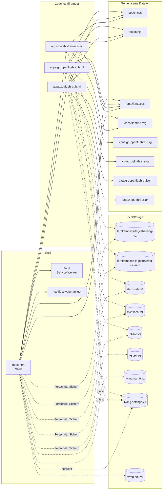
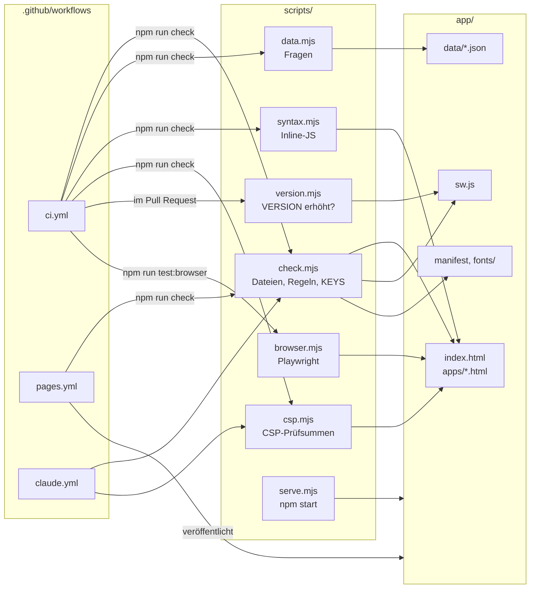

# Abhängigkeiten

Welche Datei welche lädt, wer welchen Lernstand liest oder schreibt und welches Skript was prüft. Ergänzt [ARCHITEKTUR.md](ARCHITEKTUR.md). GitHub zeigt die Diagramme direkt an.

Bei neuen Dateien, Schlüsseln oder Prüfungen hier mitpflegen.

## Laufzeit: Shell, Coaches, Dateien, Speicher

Durchgezogene Pfeile: lädt bzw. bettet ein. Gestrichelte Pfeile: liest oder schreibt im `localStorage`.

- Jeder Coach schreibt nur seine eigenen Schlüssel. Die Shell liest sie für Fortschritt und „Weitermachen“ und schreibt sie nur beim Wiederherstellen einer Sicherung (alle Schlüssel aus `KEYS`).
- Einziger geteilter Schlüssel ist `fwmg.settings.v1`: Die Shell schreibt ihn, Gruppen- und Zugführer übernehmen ihn beim Start, wenn er neuer ist.
- `sw.js` legt alle Dateien aus den Blöcken „Shell“, „Coaches“ und „Gemeinsame Dateien“ in den Cache, dazu die Schriftdateien und App-Icons.

## Prüfen und Veröffentlichen

`npm run check` führt `check.mjs`, `data.mjs`, `syntax.mjs` und `csp.mjs` nacheinander aus (`package.json`).
